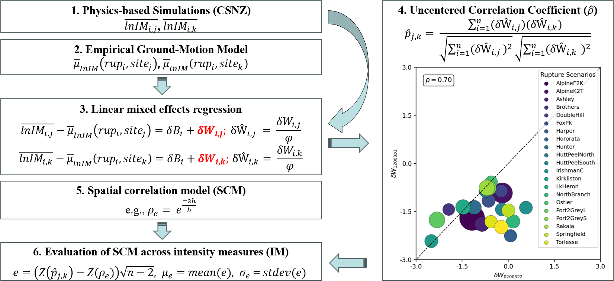

# Ground-Motion Correlation Evaluation



Python tools and Jupyter notebooks for **evaluating ground-motion spatial correlation structure** using observational ground-motion datasets. The workflows cover empirical correlation estimation, assessment of published spatial correlation models (SCMs), regional variability, development of non-stationary formulations, and evaluation of predictive and practical performance.

The initial application uses the **New Zealand Ground-Motion Database (NZGMDB) v4.3**. The methods and supporting functions are intended to be applicable to other ground-motion datasets and regions.

## Scientific scope

A spatial correlation model describes the dependence between within-event ground-motion residuals at different recording sites. Evaluating this dependence is important for determining whether an SCM adequately represents observed ground-motion variability, particularly when applied outside its calibration region.

The workflows support:

- **Residual preparation:** ground-motion model (GMM) predictions and event/within-event residual partitioning.
- **Empirical spatial correlations:** station-pair correlations and site-pair characteristics, including separation distance, source-to-site azimuth, and site-property dissimilarities.
- **SCM evaluation:** comparison of modelled and empirical correlations using Fisher-transformed correlation deviations, their summary statistics, and dependence on dissimilarity parameters.
- **Non-stationary SCMs:** model formulations incorporating directional, geological, and site-related covariates; Bayesian parameter estimation and model comparison.
- **Regional and practical assessment:** comparison of NZ-wide and regional correlation structure, predictive evaluation, and applications to spatially distributed ground motions.

The emphasis is on **evaluating when a model is adequate and whether additional complexity provides a meaningful improvement**, rather than assuming that increasingly complex SCMs are necessarily preferable.

## Repository structure

```text
groundmotion-correlation-evaluation/
├── notebooks/                # Analysis workflows and publication figures
│   ├── PHD_OBJ2_GMMRES.ipynb
│   ├── PHD_OBJ2_NZSCM.ipynb
│   ├── PHD_OBJ2_PYMC.ipynb
│   ├── PHD_OBJ2_ESUP_GMMSEL.ipynb
│   ├── PHD_OBJ2_ESUP_MODSEL.ipynb
│   ├── PHD_OBJ2_RISK_SUMMARY.ipynb
│   ├── PBDV_R26.ipynb
├── src/                      # Reusable Python functions
│   ├── cbb21_cossim.py
│   ├── cbb21_gmres.py
│   └── cbb21_gmscm.py
├── data/
│   ├── residuals/            # Ground-motion inputs and residual tables
│   ├── nzwide_scm/           # SCM parameters and evaluation inputs/results
│   └── risk/                 # Scenario portfolio-loss curves
├── figures/                 # Generated figures and visualisations
├── results/                 # Derived analysis outputs
├── requirements.txt
├── requirements-research.txt
└── README.md
```

### Notebooks

| Notebook | Analysis |
| --- | --- |
| [`PHD_OBJ2_GMMRES.ipynb`](notebooks/PHD_OBJ2_GMMRES.ipynb) | GMM predictions, residual partitioning, and preparation of normalized within-event residuals. |
| [`PHD_OBJ2_NZSCM.ipynb`](notebooks/PHD_OBJ2_NZSCM.ipynb) | Empirical spatial correlations, existing SCM comparisons, regional analyses, and correlation-deviation diagnostics. |
| [`PHD_OBJ2_PYMC.ipynb`](notebooks/PHD_OBJ2_PYMC.ipynb) | Bayesian fitting of stationary and non-stationary SCMs and related model evaluation. |
| [`PHD_OBJ2_ESUP_GMMSEL.ipynb`](notebooks/PHD_OBJ2_ESUP_GMMSEL.ipynb) | Sensitivity of inferred correlation structure to GMM selection (Electronic Supplement A and associated analyses). |
| [`PHD_OBJ2_ESUP_MODSEL.ipynb`](notebooks/PHD_OBJ2_ESUP_MODSEL.ipynb) | Feature selection, alternative non-stationary formulations, and predictive model comparisons (Electronic Supplement C). |
| [`PHD_OBJ2_RISK_SUMMARY.ipynb`](notebooks/PHD_OBJ2_RISK_SUMMARY.ipynb) | Scenario portfolio-loss exceedance curves for the three ruptures, comparing national and regional SCMs. |
| [`PBDV_R26.ipynb`](notebooks/PBDV_R26.ipynb) | Conditional/unconditional spatial IM fields and leave-one-station-out conditional IM (LOOCIM) evaluation for the selected New Zealand earthquakes. |

The notebooks are research workflows rather than standalone demonstrations. Some analyses require derived tables or fitted-model outputs from preceding steps; the scenario applications additionally require prepared input data and raster products.

### Python modules

| Module | Main functionality |
| --- | --- |
| [`cbb21_gmres.py`](src/cbb21_gmres.py) | GMM residual calculations and event/within-event partitioning. |
| [`cbb21_cossim.py`](src/cbb21_cossim.py) | Station-pair calculations, spatial correlation estimates, dissimilarity metrics, and smoothing utilities. |
| [`cbb21_gmscm.py`](src/cbb21_gmscm.py) | Published SCM formulations, model-predicted correlations, and correlation-deviation evaluation. |

## Getting started

Clone the repository and create an isolated Python environment:

```bash
git clone https://github.com/AaronJR474/groundmotion-correlation-evaluation.git
cd groundmotion-correlation-evaluation
python -m venv .venv
```

Activate the environment using the appropriate command for your system (`.venv\Scripts\activate` on Windows or `source .venv/bin/activate` on Linux/macOS), then install the general requirements and open JupyterLab:

```bash
python -m pip install -r requirements.txt
python -m jupyter lab
```

For Bayesian fitting, spatial conditioning/LOOCIM, and the PyGMT case-study figures, also install the research dependencies:

```bash
python -m pip install -r requirements-research.txt
```

The [`VarioCorreKrigE`](https://github.com/AaronJR474/VarioCorreKrigE) and [`pygmf`](https://github.com/AaronJR474/pygmf) projects are included as Git dependencies in that file. `VarioCorreKrigE` is used for empirical variogram/correlation fitting in `PHD_OBJ2_NZSCM.ipynb`; `pygmf` provides conditional-field computations and LOOCIM in `PBDV_R26.ipynb`. For PyGMT maps, the **native GMT library must also be installed** (for example via conda-forge); installing `pygmt` with pip alone is not sufficient. Some relief maps are downloaded through GMT on first use and may also require network access. The residual-generation notebook additionally requires a compatible **OpenQuake engine** installation. The Bayesian fitting notebook enables JAX 64-bit precision explicitly.

The dependency files describe the required packages but are not a tested, fully pinned reproducibility lockfile. For publication-grade recreation, use the environment associated with the tagged analysis release.

Each notebook includes a configuration cell that locates the repository and makes the `src/` modules available, so the notebooks can be opened from the repository root or the `notebooks/` directory. External project dependencies (`VarioCorreKrigE` and `pygmf`) must be installed separately as described above.

## Data and reproducibility

The observational application uses NZGMDB v4.3 ground-motion and station information together with derived residuals and site-property data. Inputs are organized under:

- [`data/residuals/`](data/residuals/README.md): ground-motion records, GMM inputs, station metadata, and within-event residual tables.
- [`data/nzwide_scm/`](data/nzwide_scm/README.md): fitted SCM parameter summaries, predictive evaluation tables, and related model inputs or outputs.
- [`data/risk/`](data/risk/README.md): national and regional portfolio-loss exceedance curves for the three selected ruptures.

The directory-specific README files describe the expected filenames and organization. To reproduce a particular analysis, the corresponding datasets and previously generated intermediate results must be available at the paths used by its notebook. Computationally intensive fitting stages may require substantial memory and processing time.

**Data provenance:** Original ground-motion data, site-property products, and third-party model inputs remain subject to the terms of their respective providers. Availability of code in this repository does not imply permission to redistribute those datasets. Where source data cannot be distributed, the notebooks and input specifications document the required processing workflow.

## Related research and citation

This repository supports the observational and model-evaluation analyses presented in the accompanying manuscript:

> *A Framework for Evaluating Ground-Motion Spatial Correlation Models: Insights from New Zealand on Regional Variability and Non-Stationary Extensions.*

Bibliographic details and a persistent release identifier will be added when available. In the meantime, cite the repository URL and the specific commit or release used. Please also cite the original publications associated with any empirical GMMs and SCMs applied through these workflows.

## License

See the repository's `LICENSE` file for the terms governing reuse of the source code. Licences and attribution requirements for third-party datasets and dependencies apply separately.
